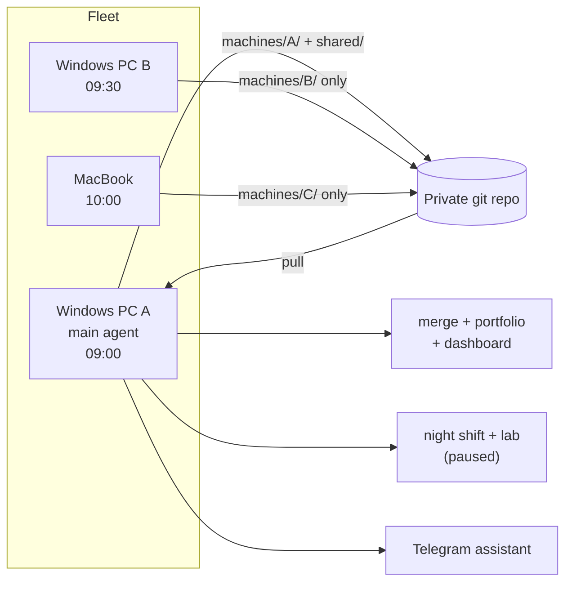
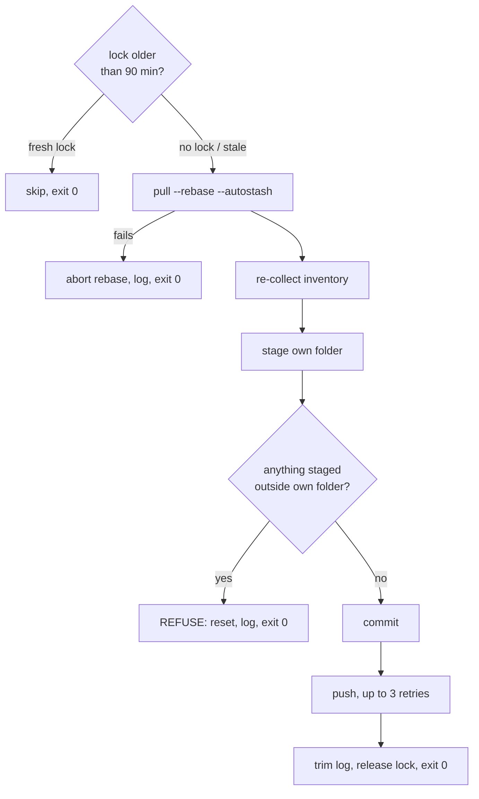
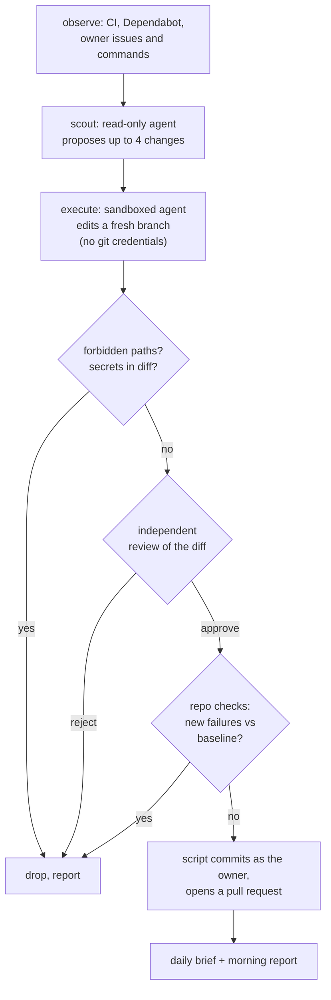

# Agent Fleet Hub

A small, self-running coordination hub for one developer's machines and projects. It inventories
every project and coding-agent session on each machine, merges duplicates into one honest list,
and keeps everything on GitHub under a single identity. On top of that sits an autonomous
"night shift" that proposes improvements as reviewed pull requests, a small lab that grows new
projects milestone by milestone, and a Telegram assistant that is the owner's single channel
into all of it.

**since Sep 2026, active · Python · PowerShell · Bash · code: private**
## The problem

I build most of my software with coding agents (Claude Code and Codex), on two Windows PCs and a
MacBook. A few months in, three things had gone wrong:

- **Work drifted into copies**: backup folders, old-PC migrations, downloads and agent
  worktrees. Nobody could say how many projects there really were.
- **Agent sessions were invisible.** Much of the work done in agent sessions sat in local
  transcript folders and had no commit history at all.
- **Commit identity was split.** Commits had been authored under an address tied to a second,
  dormant GitHub account, or under machine-generated addresses. Hundreds counted toward the
  wrong profile, or toward none.

Once that was under control, a fourth problem was obvious: dozens of repositories, one person,
and no time to keep them all maintained.

## What it does

- **Inventories each machine**: projects, languages, git history, and Claude Code and Codex
  sessions bound to the project they ran in. Metadata only, with secrets and long digit runs
  redacted on the way in. It also reports work at risk: unpushed commits, changes left
  uncommitted for days, repositories with no remote, and low disk space.
- **Merges across machines.** At the last full merge, 57 raw folder entries became 22 real
  projects, with every agent session bound to the project it ran in. Copies are matched by their
  root commit, and a duplicate report lists copies that are safe to archive (moved, never
  deleted, and only after the owner confirms each one).
- **Renders a portfolio page** where every number is computed and every doubtful number carries
  its caveat, plus a private dashboard of machines, projects and agent activity.
- **Syncs itself.** Each machine refreshes and pushes its own inventory daily, unattended.
- **Puts repos under one identity before their first push**, and strips oversized files from
  history when needed. One repository went from 710 MB to 158 MB.
- **Runs a night shift.** Once a day, agents look at the owner's repositories, propose small
  improvements with evidence, write them on a fresh branch, and open a pull request only after
  automated gates and an independent review pass. Every change so far went through the owner's
  review: 50 pull requests accepted, 2 rejected.
- **Runs a project lab.** A backlog of ideas feeds a few active lab projects, each advanced one
  milestone per night until it is a candidate the owner can publish or archive.
- **Answers in Telegram.** A paired-user bot reports status in plain language, explains a pull
  request, and runs whitelisted actions (merge, reject, pause, file a task) behind a confirm
  button. It accepts voice messages too.
- **Checks itself every night.** The bot takes a fixed exam built from the owner's real
  messages, its replies are compared with the status it actually saw, and every mistake found
  becomes a task and a new exam case.
- **Publishes its own showcase.** These public pages are generated from approved texts only,
  after a scrub gate and a human read of the diff.
- **Keeps remote access alive** with a watchdog that restarts a hung remote-desktop service.

**Current state:** on 2026-10-17 the owner paused the night shift, the lab and its sprints with
one policy switch. Inventory, sync and the Telegram assistant keep running.

## How it works

Every machine holds a clone of one private git repository. Each machine writes only its own
folder, so two machines never touch the same bytes. The main machine also owns the shared
files: merged inventory, night-shift policy and state, daily briefs and the showcase.

One scheduled cycle on a peer:

One night shift, per repository:

## Engineering notes

- **The invariant is enforced in code.** If anything outside the machine's own folder is
  staged, the sync resets and refuses. It fired on its first real run: it caught another
  machine's files that were staged for removal.
- **Built for a scheduler.** Each run has a lock that goes stale after 90 minutes, a log capped
  at 500 lines, and an exit code of 0 whatever happens. Runs are staggered so machines never
  rebase at once. Tasks run only while the user is logged in, by choice: the alternative is
  storing a password in a scheduled task.
- **Merge, group, relate.** Copies of one codebase merge: sessions add up, but file counts take
  the largest copy and are never summed. Sibling variants group. Projects in the same domain are
  only cross-linked. Git evidence beats folder names: nine "separate" folders turned out to be
  runs of one repository.
- **Generated output is not counted as code.** One project had 3,507 of 3,655 files as captured
  HTML, with 148 real source files; the page says so.
- **Rewrite with a backup, and verify it.** The re-author tool refuses repos that already have a
  GitHub remote or linked worktrees. It saves uncommitted work and rewrites a mirror. It then
  checks four things: the same commit count, the same tip tree, the same per-day commit pattern,
  and a single author. Only then does it push and move the live branch with a soft reset.
- **Agents propose, scripts decide.** The code-writing agent never holds git credentials; the
  script commits, pushes and opens the pull request. Gates run in order: forbidden and
  review-only path rules, a secret scan, a review by a different model, then the repo's own
  checks. A change is judged by *new* failures against a cached baseline, so repositories whose
  suites are already red on this machine can still be improved without hiding regressions.
- **Trust is earned and counted.** Self-merge is allowed only for small changes, and only after
  ten owner-accepted pull requests in a row; the policy file that sets this is human-owned and
  the shift never writes it. To date nothing has been self-merged.
- **Every engine has a fallback, and every failure is reported.** Code writing, scouting and
  review each have a chain across Codex, Claude and Antigravity (Gemini). A usage-limit message
  stops that engine for the rest of the night, never retried. An outage of one engine went
  unnoticed for days once; since then every engine error is listed in the brief.
- **A sandbox for tools the PC lacks.** A WSL2 Ubuntu distro with Go, Rust, Java, Node and
  Ollama runs lab checks, with Windows drive mounting and Windows interop switched off, so
  nothing inside can read the owner's files. Lockfiles that need the network are generated
  there and copied back by fixed name.
- **A bot that does not invent.** Fact answers (dashboard, project lookup, usage) send only the
  function's result, never the language model's text. Replies that ask for a key are cut. Status
  shows what is really running, checked by process id. Irreversible actions need a confirm
  button, and messages are queued during quiet hours.
- **Fixed in real use.** A laptop whose hostname followed the network appeared as two machines;
  an alias map folds them back into one. An escaping bug had turned `\a` in a Windows path into
  a BEL character. Counting commits over all refs had doubled one repo's history, so commits are
  now counted from HEAD. One repository's test sent Ctrl+C to its whole console and silently
  killed the shift; checks now run in their own hidden console. Scheduled collects had silently
  lost their extra scan roots; they now live in the shared registry.

## How it is verified

- Identity resolution was tested with a real commit: one authored under the old address, which
  GitHub's API credited to the secondary account.
- The bridge counted as working only after three machines pushed on their own schedule and the
  main machine pulled all three cleanly.
- Every rewrite prints its checks and GitHub's linked or unlinked count per commit.
- The night shift counted as working only after its first scheduled run opened pull requests by
  itself; lab candidates were re-verified on fresh clones.
- The hub has its own unit tests (collector, duplicates, dashboard, night shift, bot, health, scrub,
  secret scan, self-check). The agents' own rule: a behaviour change ships with a test, and a
  deleted or skipped test is an automatic reject in review.
- The public profile was re-checked from a logged-out browser.

## Stack

Python 3, Windows PowerShell 5.1, Bash (3.2-compatible), git, GitHub CLI, GitHub Actions,
git-filter-repo, Windows Task Scheduler, launchd, WSL2, aiogram (Telegram), faster-whisper,
RustDesk, Claude Code, Codex, Antigravity.

## Access

The code is private. To request a walkthrough or read access, open an issue in this repository
or email eazamat360@gmail.com.
